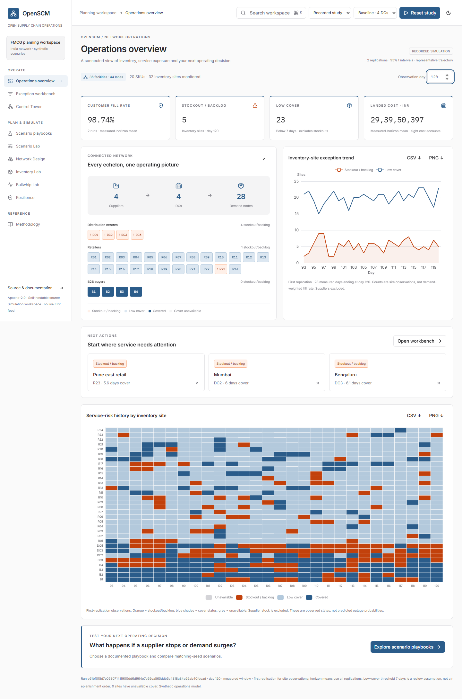

# OpenSCM · open-source supply chain simulation

An Apache-2.0 operations planning workspace for exploring sourcing, inventory,
distribution, demand and resilience with reproducible synthetic scenarios.
No proprietary dataset is required. The reference model uses an FMCG network on
Indian lanes, with costs in INR. Inputs are explicit assumptions, not live ERP data.
The [implementation plan](docs/plan.md) defines milestones M0–M12.



The operations workspace adds a visual network overview, a day-specific exception
workbench, eight operating playbooks, configurable replenishment/forecast/lost-sales
assumptions and paired simulation evidence downloads. Start at the overview, review
service exposure, investigate a site in Control Tower, then test a documented
scenario. See [workspace guide](docs/operations-workspace.md).

M0–M10 are implemented: scaffold and contracts, analytical inventory formulas,
demand generation, single-node and multi-echelon simulation, DC selection,
four inventory policies, capacity-constrained FIFO dispatch, FTL/LTL freight,
forecasting, error metrics, ABC–XYZ replenishment policies, and bullwhip causes
and countermeasures, disruption calendars, resilience metrics, and experiment grids
with paired statistics, manifests and reproducible Parquet outputs, plus a cached
FastAPI service, DuckDB filters and a generated TypeScript client, and a Next.js
Control Tower with network health, inspection, queries and local day playback,
plus Scenario Lab, Network Design, Bullwhip Lab, Inventory Lab, Resilience and
Methodology views backed by recorded experiments and live paired scenarios.
The user-requested E1 operations workspace expansion is implemented. M11
(static demo, Docker, performance and accessibility) remains next.

The E2 [Planning Lab](docs/planning-lab.md) adds server-persisted named scenarios,
notes/revisions, immutable launch history and historical-request reruns. Configure
seasonality, demand uncertainty, forecasting, supplier reliability, DC capacity,
SKU assumptions and sourcing/buffer/expedite alternatives; compare replicated
cost/service/inventory results and inspect reconciled SKU, facility and lane
contributors. Export model provenance alongside the results. Open `/?view=portfolio`
with the local API running. The guide includes a calibration/validation workflow
for moving from synthetic exercises to operating decisions.

The E3 [Learning sandbox](docs/learning-sandbox.md), at `/?view=learning`, adds ten
guided, editable experiments for students. Predict, simulate paired conditions,
interpret uncertainty, explore daily facility/SKU evidence in four chart forms,
and export a reflection notebook with exact model provenance. A concept reference
explains the daily sequence and connects the existing analytical labs. Recorded
evidence and teaching material remain usable without the simulation API.

The E6 [visual network builder](docs/network-builder.md), at `/?view=builder`,
edits custom facility/SKU masters, sourcing, DC selection, lane assumptions and
economics. Drag the Cytoscape diagram, connect customers, validate against the
engine, save/recover model revisions and run the exact versioned snapshot.
Geographic movement is explicit; diagram layout alone does not alter simulation
inputs. Import/export and the existing Planning Lab/Control Tower share the same
public model contracts.

See [analytics](docs/analytics.md) for functions, units, assumptions and examples.
See [simulation](docs/simulation.md) for daily timing, costs and reproducible M2 validation.
See [network simulation](docs/network.md) for M3 configuration, conventions and a runnable example.
See [forecasting and segmentation](docs/forecasting.md) for M4 planning and E5 evidence.
See [bullwhip](docs/bullwhip.md) for M5 switches, V7 and controlled network comparisons.
See [resilience](docs/resilience.md) for M6 event semantics, survival and recovery measurements.
See [experiments](docs/experiments.md) for M7 E1–E6 grids, CLI commands and output contracts.
See [API and query layer](docs/api.md) for M8 endpoints, caching, KPI conventions and client usage.
See [Control Tower](docs/frontend.md) for M9 recorded/live modes and browser checks.
See [study views](docs/study-views.md) for M10 controls, provenance and evidence export.

Requires Python 3.12. From this directory on Windows PowerShell:

```powershell
python -m venv .venv
.\.venv\Scripts\python.exe -m pip install -r requirements-dev.lock -e '.[dev]'
npm ci --prefix web
.\web\node_modules\.bin\playwright.cmd install chromium
.\.venv\Scripts\python.exe -m scm.check
```

On Linux/macOS:

```sh
python3.12 -m venv .venv
.venv/bin/python -m pip install -r requirements-dev.lock -e '.[dev]'
npm ci --prefix web
./web/node_modules/.bin/playwright install --with-deps chromium
make check
```

`make check` runs Ruff lint and format checks, strict mypy, schema drift checks and
pytest, OpenAPI/client drift checks, strict TypeScript, frontend unit/browser tests
and a production build. Node.js 22+
and the pinned npm packages are required. On Windows without Make,
`python -m scm.check` uses the same checks; use
the virtual environment's Python as above. `make contracts` regenerates schemas,
OpenAPI and client types. See [regeneration commands](docs/api.md) for Windows.
Run commands at repo root.

Open the recorded operations overview (no API needed):

```powershell
npm run dev --prefix web
```

Visit [localhost:5173](http://localhost:5173). For Live API mode, also start the
Uvicorn command below. Next.js proxies `/api` to localhost:8000 in development and
production. Use `npm run build --prefix web` then `npm run start --prefix web` for
the production server.

The original Control Tower is available at `/?view=tower`; playbooks are at
`/?view=playbooks`. Live paired playbooks require the local Python API. This is a
simulation and planning application; shared approvals, ERP connectors, SSO/RBAC
and distributed production job management are not implemented.

Original project code is licensed under [Apache-2.0](LICENSE), with attribution in
[NOTICE](NOTICE). Third-party dependencies retain their own licenses. See
[contributing](CONTRIBUTING.md) to add a scenario or improve the software.

The frontend includes restrained [interaction motion](docs/interaction-motion.md),
keyboard-operable builder sections, animated canvas controls and a browser-local
reduced-motion preference in the header. Scientific values remain exact.

See [contracts](contracts/README.md), [parameters](docs/parameters.md),
[assumptions](docs/assumptions.md) and [validation status](docs/validation.md).
Dependencies are introduced as each milestone needs them. API and frontend stack
choices remain as specified in the plan.
`requirements-dev.lock` records the tested dependency versions used locally and in CI.

Recreate the M2 validation evidence and plots (about half a minute locally):

```powershell
.\.venv\Scripts\python.exe -m scm.sim.validate --output docs/evidence/m2
```

Recreate the M3 risk-pooling and 455-day network performance evidence:

```powershell
.\.venv\Scripts\python.exe -m scm.sim.validate_network --output docs/evidence/m3
```

Recreate the M4 uniform-versus-segmented replenishment dry run:

```powershell
.\.venv\Scripts\python.exe -m scm.experiments.e5_dry_run --output docs/evidence/m4
```

Recreate the M5 Chen benchmark and paired cause/countermeasure evidence:

```powershell
.\.venv\Scripts\python.exe -m scm.experiments.e4_validate --output docs/evidence/m5
```

Recreate the M6 survival check and repeated paired disruption runs:

```powershell
.\.venv\Scripts\python.exe -m scm.experiments.e6_validate --output docs/evidence/m6
```

Run an experiment with the full study settings, or reproduce its smaller acceptance run:

```powershell
.\.venv\Scripts\python.exe -m scm.experiments.runner E3 --output data/experiments
.\.venv\Scripts\python.exe -m scm.experiments.runner E3 --config configs/m7_validation.yaml --output docs/evidence/m7
```

Replace `E3` with any of `E1` through `E6`. Full study grids can require thousands
of replications; saved M7 acceptance evidence uses reduced replication counts.

Start the local API and recreate M8 acceptance evidence:

```powershell
.\.venv\Scripts\python.exe -m uvicorn api.app.main:app --host 127.0.0.1 --port 8000
```

In another terminal:

```powershell
.\.venv\Scripts\python.exe -m scm.api_validate --output docs/evidence/m8
```

The interactive API documentation is at [localhost:8000/docs](http://localhost:8000/docs).
