# OpenSCM · supply-chain decision stress lab

**Frame an operating decision, compare plans, inspect the evidence and keep a recommendation you can defend.**

A persistent **Decision Case** connects the operating question, model, complete A/B
conditions, goals, prediction, run evidence and decision notes. The network builder,
Planning Lab, learning sandbox and live inspectors become tools for that investigation.
Start with reproducible synthetic data; no proprietary dataset or ERP connection
is required. The reference study models an FMCG supply chain on Indian lanes, with
costs in INR. Original project code is licensed under [Apache-2.0](LICENSE).

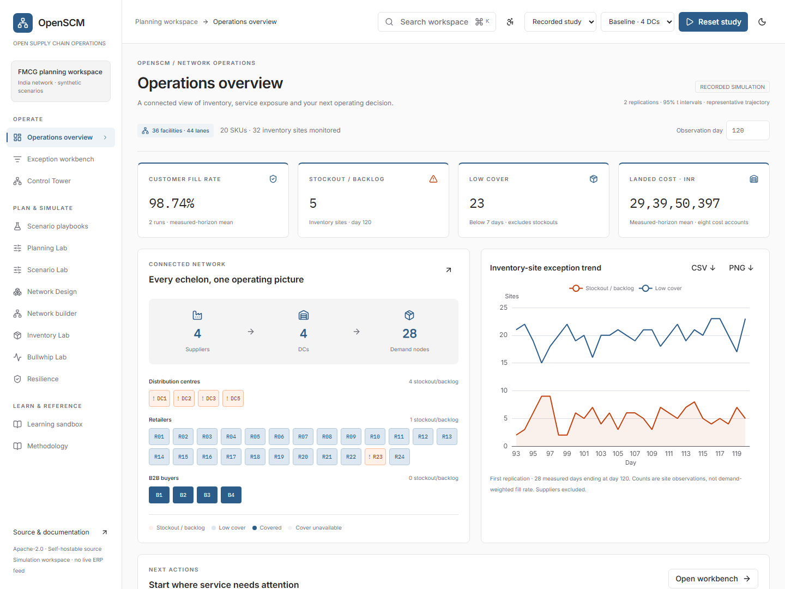

*Recorded reference simulation at observation day 120. Orange identifies stockout
exposure; these are synthetic study outputs, not live business performance.*

[Quick start](#quick-start) · [Feature walkthrough](#feature-walkthrough) ·
[Guided workflows](#guided-workflows) · [Model and evidence](#model-and-evidence) ·
[Architecture](#architecture) · [Documentation](#documentation)

## Quick start

Use **Python 3.12** and **Node.js 22+**. Run commands from the repository root.

<details>
<summary>Windows PowerShell installation</summary>

```powershell
python -m venv .venv
.\.venv\Scripts\python.exe -m pip install -r requirements-dev.lock -e '.[dev]'
npm ci --prefix web
.\web\node_modules\.bin\playwright.cmd install chromium
```

</details>

<details>
<summary>Linux and macOS installation</summary>

```sh
python3.12 -m venv .venv
.venv/bin/python -m pip install -r requirements-dev.lock -e '.[dev]'
npm ci --prefix web
./web/node_modules/.bin/playwright install --with-deps chromium
```

</details>

Start the frontend:

```sh
npm run dev --prefix web
```

Open [localhost:5173](http://localhost:5173) for Decision Cases (requires the API).
For an API-free entry, open [the recorded operations overview](http://localhost:5173/?view=overview).
**Recorded study** mode works without
the simulation API for the operations views and recorded analytical labs.
To save scenarios/models, validate topology or execute new simulations, start the
local API in another terminal:

```powershell
# Windows
.\.venv\Scripts\python.exe -m uvicorn api.app.main:app --host 127.0.0.1 --port 8000
```

```sh
# Linux/macOS
.venv/bin/python -m uvicorn api.app.main:app --host 127.0.0.1 --port 8000
```

The frontend proxies `/api` to the local service in development and production.
API documentation is available at [localhost:8000/docs](http://localhost:8000/docs).
For a production-mode local preview, run `npm run build --prefix web`, then
`npm run start --prefix web`.

## Feature walkthrough

### One case from question to decision

Start a capacity, demand, inventory or sourcing investigation from ten documented
templates. Record your prediction and acceptance goals, configure both conditions,
save and run. Review actual paired intervals and service/cost/inventory trade-offs,
inspect the live run, then save your observations and recommendation. Learning can
save a full case; Planning Lab and the builder can load/update a case condition.

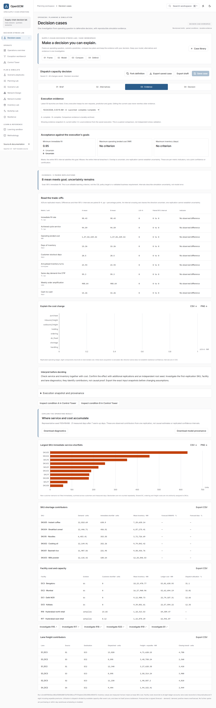

*Actual seeded capacity comparison from the E4 browser journey. Evidence retains
its launch revision when the current notebook changes. Imported archives are
explicitly unverified; reference labs are labelled separately from case runs.*

Cases include revision conflicts/history, browser draft recovery, definition forks,
versioned JSON packages and Markdown decision briefs. See [the case guide](docs/decision-cases.md).
This foundation does not yet implement decision-time replay or bounded failure
search; those remain E5/E7. Synthetic evidence is not a real-world certification.

The sidebar starts with **Decision cases**, followed by the 13 existing tools in
**Operate**, **Plan & simulate** and **Learn & reference**. Append a route below to `http://localhost:5173/` to open a
module directly. Daily observation, selected facility and module are reflected in
the URL; a URL does not preserve every unsaved form field.

| Module | Route | What you can do | Data availability |
| --- | --- | --- | --- |
| Decision cases | `?view=cases` (home) | Save complete investigations, compare A/B, assess goals and export decision briefs | Local API; archived evidence survives raw cache removal |
| Operations overview | `?view=overview` | Read service exposure, coverage and trends; open the next investigation | Recorded or completed live run |
| Exception workbench | `?view=exceptions` | Filter daily exceptions, review sites and open inspectors | Recorded or completed live run; review flags are browser-local |
| Control Tower | `?view=tower` | Explore topology, scrub days, query facilities and inspect inventory | Recorded or completed live run |
| Scenario playbooks | `?view=playbooks` | Choose a documented operating problem and configure a paired scenario | Browse without API; launch with API |
| Planning Lab | `?view=portfolio` | Save named scenarios, retain revisions/history, compare and explain runs | Local API required |
| Scenario Lab | `?view=scenario` | Compare A/B networks, event assumptions and cost/service outcomes | Recorded cases or new paired API runs |
| Network Design | `?view=network` | Explore DC-count, risk-pooling, freight and placement trade-offs | Recorded experiment slices |
| Network builder | `?view=builder` | Edit and connect a supported network, validate, save and simulate it | Starter editable offline; validation/save/run need API |
| Inventory Lab | `?view=inventory` | Explore EOQ, replenishment traces and service versus inventory cost | Analytical calculator and recorded evidence |
| Bullwhip Lab | `?view=bullwhip` | Inspect amplification, cause toggles and countermeasure combinations | Recorded experiment slices |
| Resilience | `?view=resilience` | Examine disruption trajectories, survival, recovery and sensitivity | Recorded experiment slices |
| Learning sandbox | `?view=learning` | Predict, run a guided experiment, explore evidence and reflect | Reference/recorded explorer offline; new runs need API |
| Methodology | `?view=methodology` | Inspect formulas, sources, assumptions and verification evidence | Recorded reference material |

### Operations overview and exceptions

Start with **Operations overview** to connect customer service, network coverage,
stockout exposure and operating cost. Change the observation day to see where
inventory is held and which sites need attention. Open the exception workbench to
move from a network summary to a facility-level investigation.

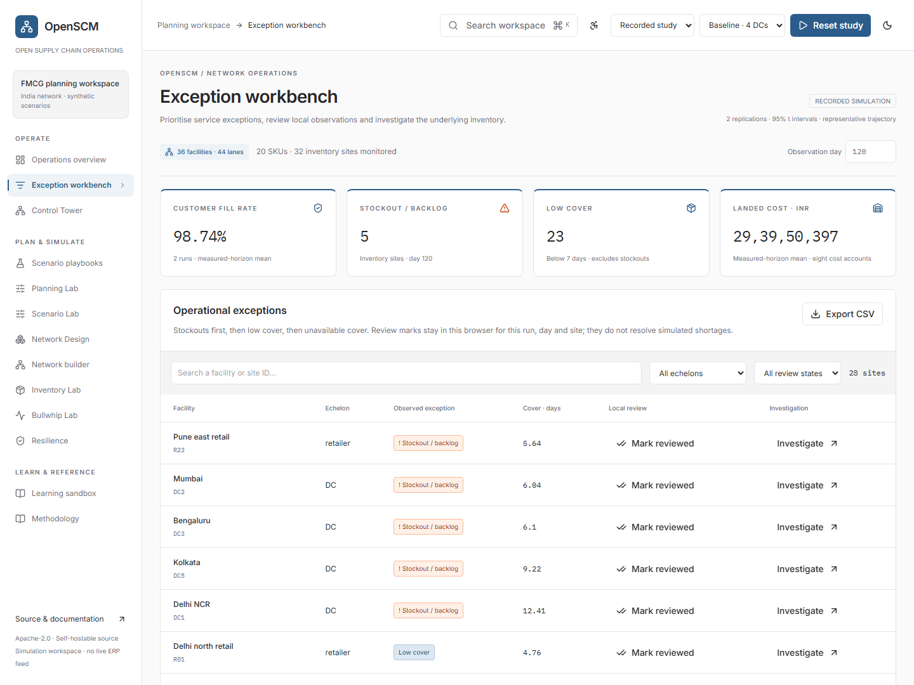

In **Exception workbench**, filter the selected day's exceptions, search for a
facility, inspect its exposure and mark it reviewed. Review flags are scoped to
run, day and facility and stored in this browser. Marking an exception reviewed
records your investigation; it does not replenish inventory or resolve a stockout.

[Operations workspace guide](docs/operations-workspace.md)

### Control Tower and facility inspection

Pan and zoom the Cytoscape network to follow suppliers, DCs, retailers and B2B
buyers. Scrub the simulation day locally, inspect a selected site, or apply a
supported query such as `warehouses with days of cover < 7`. Use the query results
to narrow the investigation, then open the facility inspector.

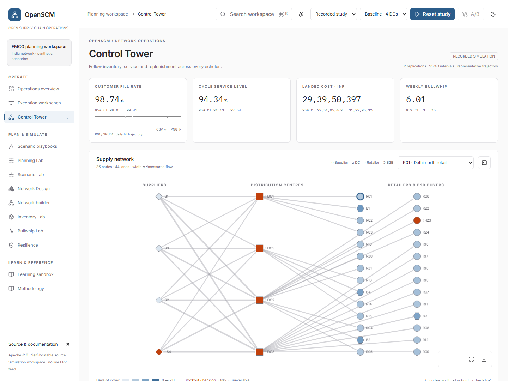

The inspector connects the selected facility and SKU to on-hand inventory,
on-order quantities, backorders and replenishment thresholds. Export the displayed
inventory series as CSV. KPI estimates use all replications; network health and
inventory trajectories describe the representative replication identified by the
view. They are different grains of evidence.

<details>
<summary>See the facility inspector</summary>

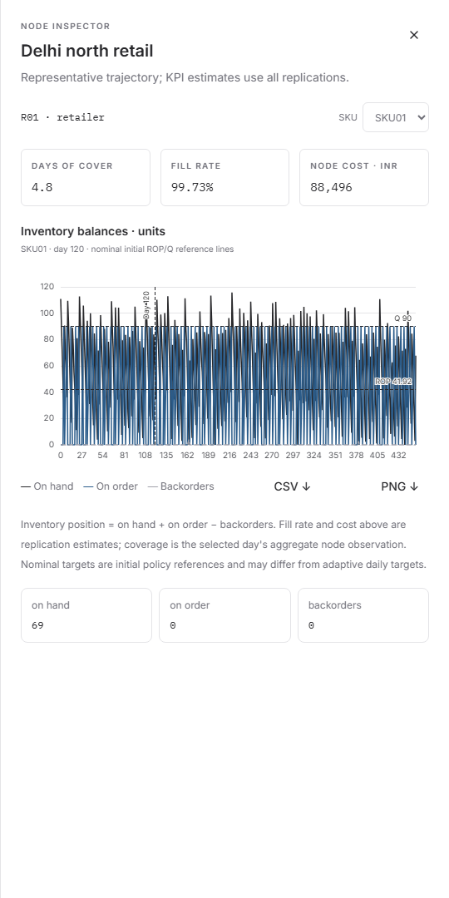

*Recorded facility trajectory. The inspector retains keyboard focus and returns it
to the trigger when closed.*

</details>

[Control Tower guide](docs/frontend.md)

### Operating playbooks and Scenario Lab

**Scenario playbooks** turns an operations question into explicit simulation
inputs. Eight exercises cover demand surges, supplier interruption, weather delays,
DC capacity constraints, higher minimum order quantities, promotion/price trade-offs,
centralised versus regional distribution, and combined sourcing/demand stress.
Each explains its question, mechanism, assumptions and what to watch.

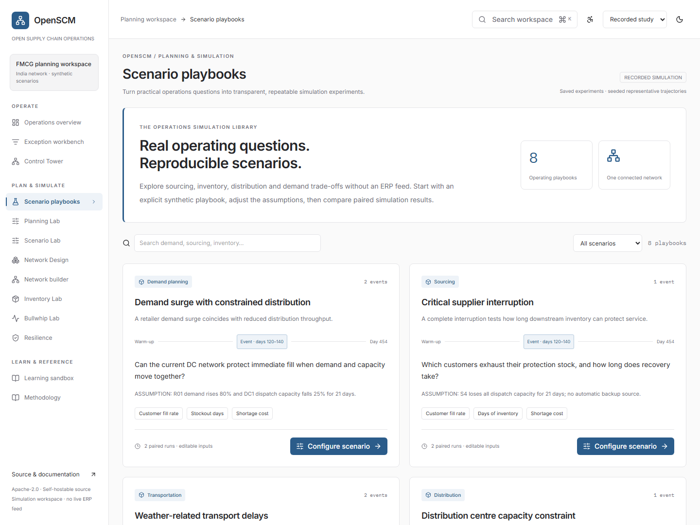

Choose **Configure scenario** to open the paired exercise in **Scenario Lab**.
Select A/B DC counts, planning assumptions, replenishment policy, shortage treatment,
seed and replications; edit event magnitude, timing and duration where supported.
Run the pair through the API and compare the resulting cost, service and inventory.
Changing an input marks existing results as belonging to the submitted snapshots.

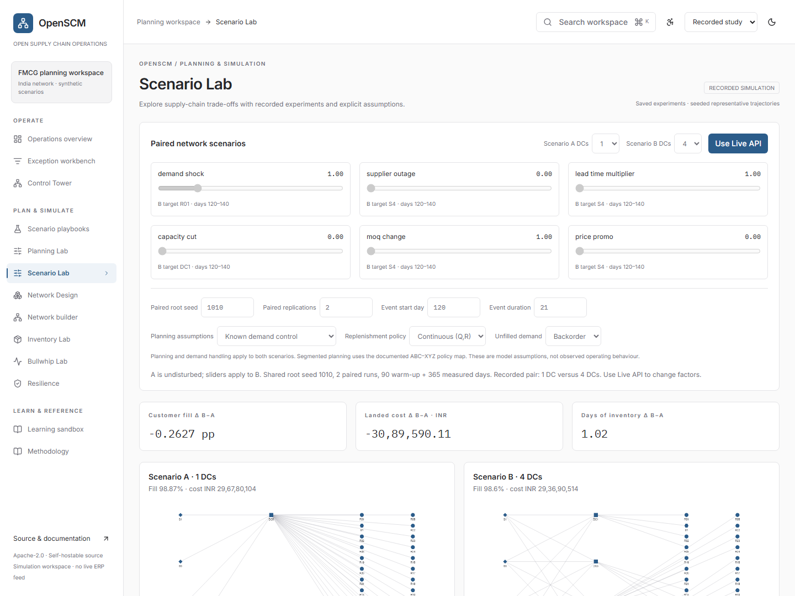

*This screenshot shows a recorded pair. Recorded selectors display saved experiment
cases; a new operating experiment requires an explicit live run. Matched seeds and
windows support paired differences and their uncertainty intervals.*

[Study-view controls and exports](docs/study-views.md)

### Planning Lab and result explanations

Use **Planning Lab** for a repeatable investigation. Give the scenario a name and
planning notes, configure assumptions, save it, and launch the saved revision.
The server retains named definitions, optimistic revisions and immutable execution
snapshots. Save-as-new creates an alternative; launch history supports inspection
and rerunning a historical request.

The editor exposes seasonal demand indices, forecast method/window and error
assumptions, supplier reliability and sourcing alternatives, DC capacity, SKU
assumptions, inventory protection and expedite controls. Inputs retain their units
and documented meaning. For example, safety buffers affect initial stock and
configured targets; they do not implement an unrestricted ongoing inventory rule.

<details>
<summary>See the full Planning Lab assumption editor</summary>

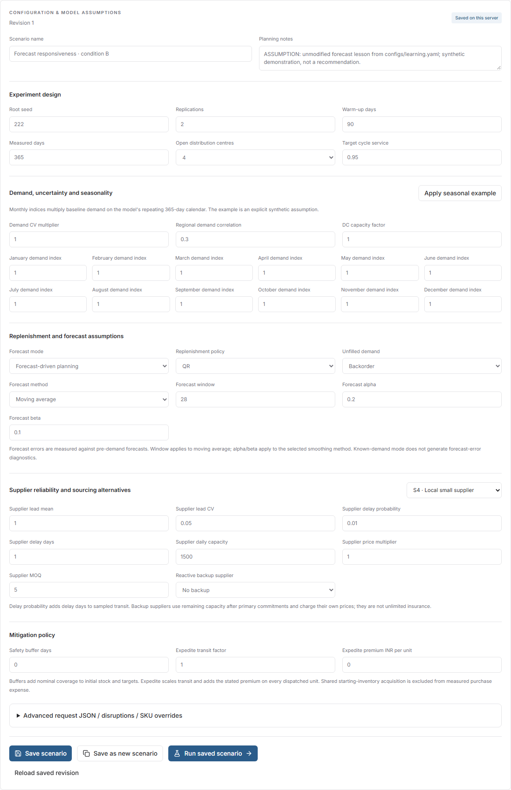

</details>

Choose a completed baseline A and compare it with B. The comparison shows each
scenario's estimate, **B−A** and the paired interval for cost, service and inventory.
Download the comparison evidence to retain the source run IDs and assumptions.

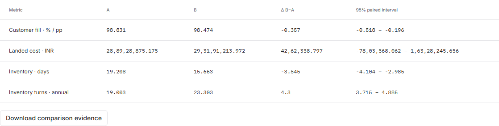

*Actual API output from the canonical forecast-responsiveness lesson: two paired
replications, a 90-day warm-up and a 365-day measured horizon. These screenshots
illustrate the software, not a statistically established business recommendation.*

Below the comparison, inspect SKU shortage contributors, facility cost/capacity,
lane freight, forecast diagnostics and the cost ledger. These are reconciled
observations from the representative replication; a contributor ranking alone
cannot establish the effect of a mitigation. Run the alternative to evaluate it.

<details>
<summary>See the SKU, facility and lane diagnostics</summary>

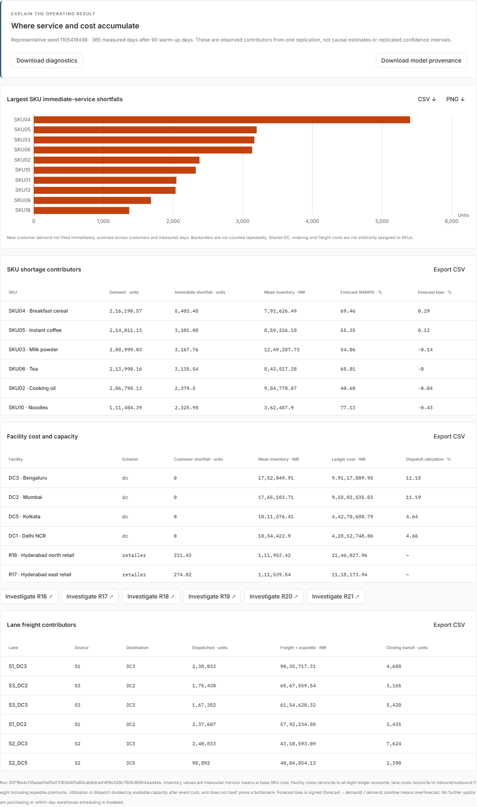

</details>

[Planning Lab methods, persistence and calibration](docs/planning-lab.md)

### Visual network builder

Build a supported **supplier → DC → retailer/B2B** network in **Network builder**.
Start from the reference model; edit facility and SKU masters, primary sourcing,
open DCs, customer assignments, lane assumptions and transport/inventory economics.

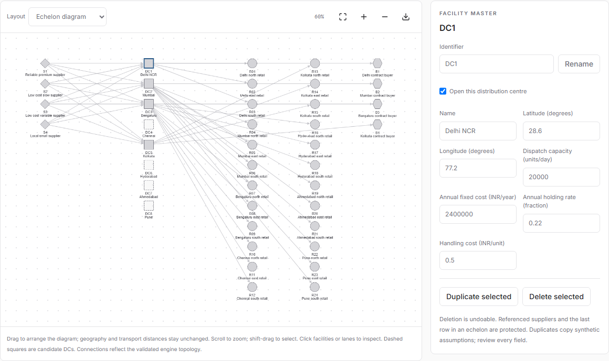

1. Add or duplicate a facility/SKU, select it on the canvas or in a master table,
   and edit its supported fields. Reference-safe edits keep linked IDs consistent;
   invalid references and unsupported topology receive validation errors.
2. Drag nodes in **Echelon diagram** mode to arrange the view. Switch explicitly to
   **Geographic sketch** to edit coordinates. Diagram movement does not change
   physical geography or transport distance.
3. Select **Connect DC → customer**, click an open DC, then its customer. Inspect
   resolved lanes to override distance, lead time or delay assumptions. Automatic
   placement/routing and manual assignments have distinct, documented semantics.
4. Review engine validation and workload limits, save the model, then run the
   saved revision. Preview validates inputs and routing; it does not execute a
   simulation. Capacity bars describe configured inputs rather than throughput.
5. Use undo/redo, import/export versioned JSON, restore a saved revision as a new
   draft, export the diagram PNG, or hand the model to Planning Lab/Control Tower.

Hover a facility to highlight nearby lanes. Zoom/fit controls animate deliberately,
show the current zoom and respond immediately with reduced motion. Builder data
sections support arrow keys and Home/End. Saved revisions persist on the server;
unsaved drafts and their undo stacks belong to the open module session.

[Builder workflow, routing semantics and model limits](docs/network-builder.md)

### Student learning sandbox

The **Learning sandbox** provides ten editable guided experiments across inventory,
demand uncertainty, forecasting, replenishment, capacity, sourcing and disruption.
Each lesson states an operating question, mechanism, explicit A/B changes and a
reflection prompt. Students can inspect the assumptions before running anything.

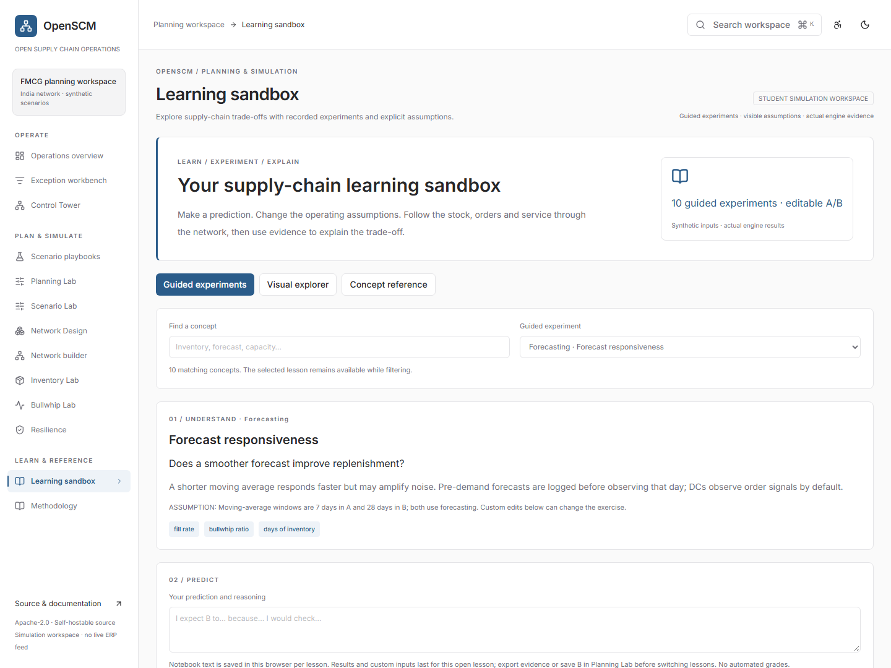

The learning loop is **question → prediction → experiment → evidence → reflection**:

1. Select a concept and write a prediction.
2. Inspect the changed-input table; optionally customise A and B. Keep seeds,
   replication counts and day windows compatible for paired comparison.
3. Run the experiment through the API. Read the metric deltas and interval-based
   indicators, including uncertain differences and service-goal qualifications.
4. Open daily A/B evidence, choose a facility and SKU, and explore the mechanism.
5. Record a reflection, save the full decision case, export notebook/evidence or save B in Planning Lab.

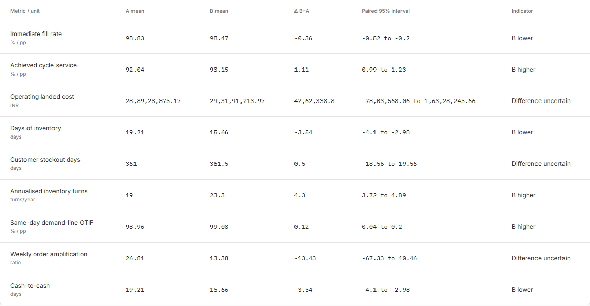

*Actual results from the unchanged forecast lesson. The session notebook is
browser-local until explicitly copied into a Decision Case. “Save full decision
case” now retains both conditions, the goal, notes and matching completed evidence
on the server; the original local notebook remains available.*

The **Visual explorer** provides ten supported daily series, facility/SKU selectors,
measured/full day windows, summary indicators and four chart forms: time trend,
daily bars, distribution and relationship. Inspect recorded evidence, the current
A/B runs or a completed custom run ID. Export the displayed series as CSV or PNG.
A daily trajectory is one replication, not a confidence interval.

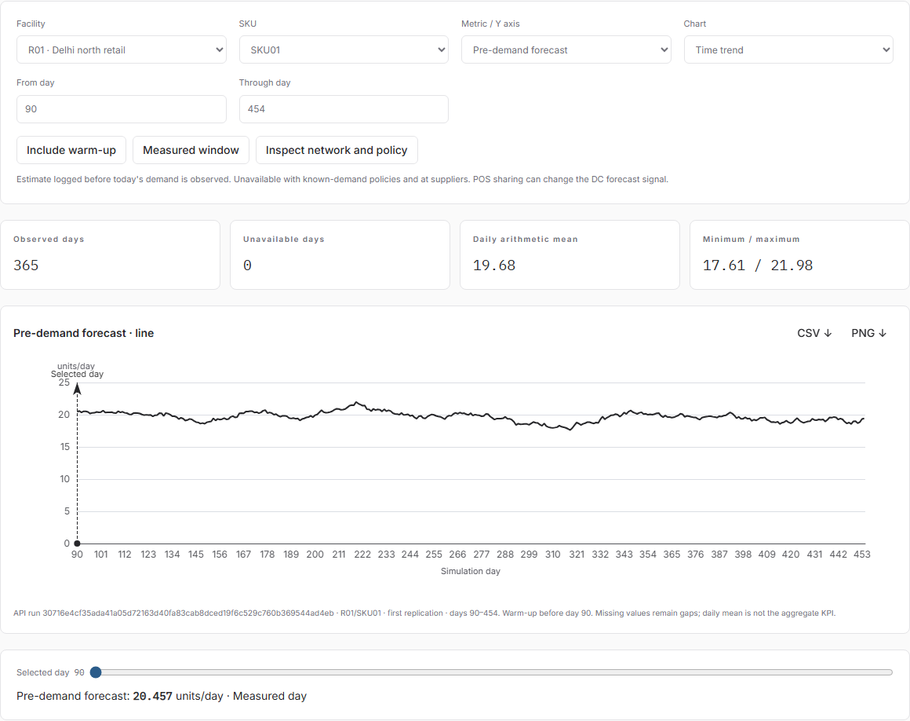

The **Concept reference** explains the daily sequence and links concepts to the
analytical labs: receive, meet demand, update forecasts, review/order, dispatch
and accrue costs. It supports an end-to-end lesson without hiding the model's
mechanisms behind a result score.

<details>
<summary>See the simulation-day reference</summary>

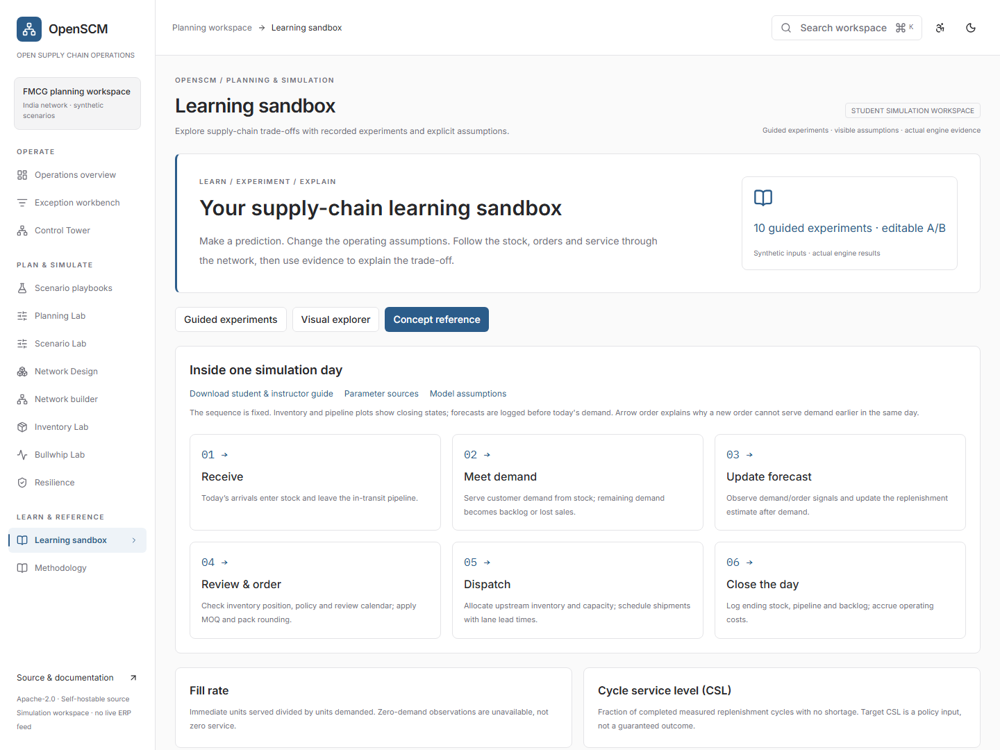

</details>

[Student/instructor guide and interpretation limits](docs/learning-sandbox.md)

### Specialist analysis labs

These labs expose analytical calculations and saved experiment slices. Their
controls select or recompute the evidence described by the source caption; they
do not silently launch a new simulation for every slider change.

| Network Design | Inventory Lab |
| --- | --- |
| 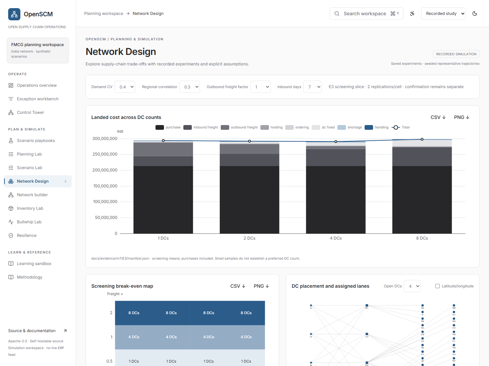 | 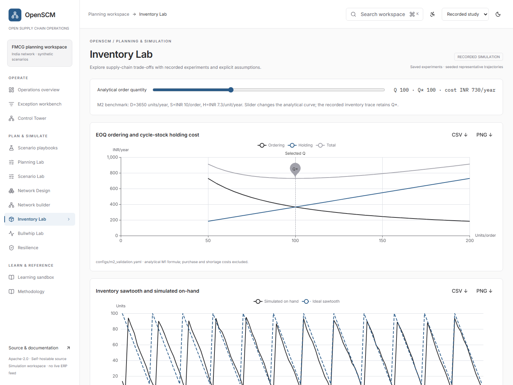 |
| Explore DC count, demand CV, regional correlation, outbound freight and inbound lead time. Inspect the cost stack, screening heatmap and diagram/geographic placement. | Change analytical order quantity, examine ordering/holding cost and the replenishment sawtooth, then select a SKU's recorded service/cost frontier. |

| Bullwhip Lab | Resilience |
| --- | --- |
| 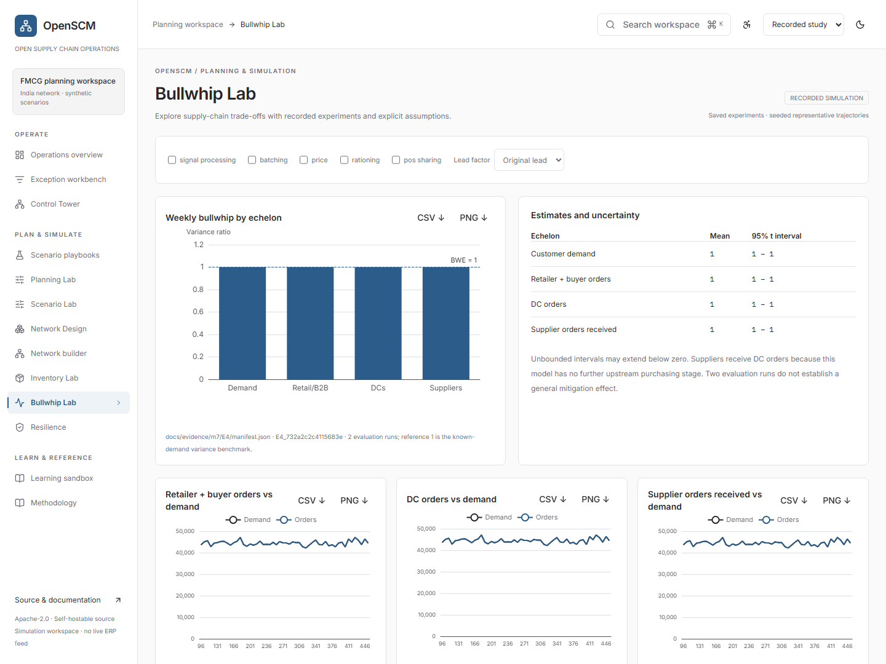 | 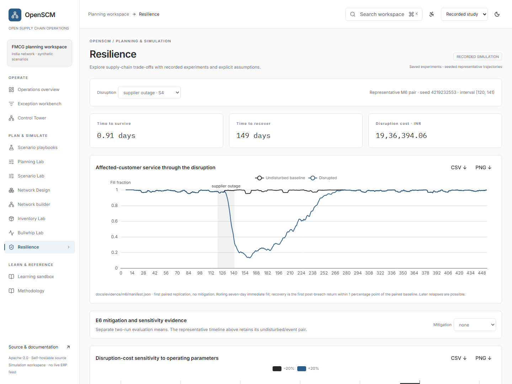 |
| Toggle signal processing, batching, price, rationing and POS sharing; compare lead-time settings and amplification across echelons. | Follow an annotated disruption, time to survive, time to recover and incremental cost. Select mitigation/sensitivity cases; distinguish unrecovered results from observed recovery. |

**Methodology** connects the interface to formulas, units, parameter sources,
assumptions and recorded verification checks. Search assumptions and download
reference Markdown documents for review.

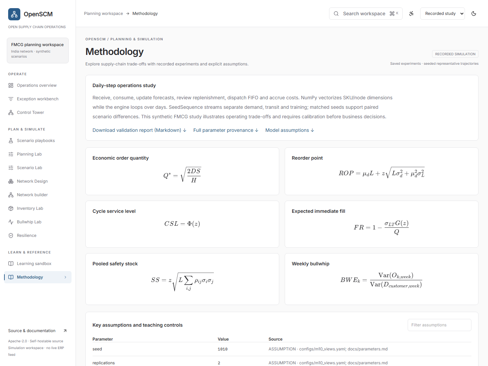

[Analytical and recorded study views](docs/study-views.md)

### Navigation, themes and motion

Use **Ctrl/Cmd+K** to search modules and facilities from the loaded network.
Narrow-screen navigation, keyboard focus indicators, a dark theme and short motion
feedback are shared across the workspace. The header's **Motion preferences**
button follows the device setting by default or lets you reduce movement explicitly.
Preferences synchronise across browser tabs where storage is available.

<details>
<summary>See dark-theme motion preferences at a narrow viewport</summary>

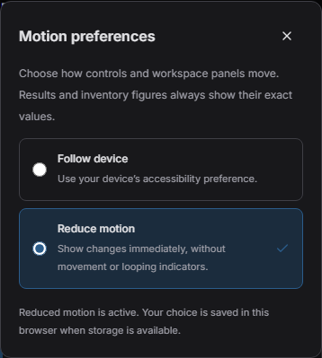

</details>

Loading states describe actual pending work. Scientific values remain exact rather
than counting up for effect. Device or browser reduced motion suppresses CSS
movement and makes explicit canvas viewport actions immediate.

[Interaction and motion guide](docs/interaction-motion.md)

## Guided workflows

| Goal | Suggested path | Keep as evidence |
| --- | --- | --- |
| Learn an inventory or planning concept | Learning sandbox → prediction → paired run → visual explorer → reflection → related analytical lab | Exported notebook, exact A/B requests, paired results and source run IDs |
| Investigate a service issue | Operations overview → day-specific exception → Control Tower inspector → documented playbook → Planning Lab comparison | Reviewed observation, assumptions, saved revisions, comparison and diagnostics |
| Study a different supply chain | Network builder → masters/routes/economics → validate → save → simulate → Control Tower/Planning Lab | Model package, saved revision, immutable launch snapshot and run provenance |

Keep the two experiment conditions interpretable: begin with one operating
question, establish a baseline, change the intended mechanism and compare matched
runs. Broaden the experiment only after checking units, assumptions and uncertainty.

## Model and evidence

The Python engine supports multi-echelon inventory, sourcing and transport with
four replenishment policies (`QR`, `sS`, `RS`, `order_up_to`), forecasting,
ABC–XYZ policy mapping, capacity-constrained FIFO dispatch, FTL/LTL freight,
seasonal/stochastic demand, disruption calendars and paired experiments.
Random draws use named `SeedSequence` streams. Scientific outputs retain input,
seed, model/version and source provenance.

| Evidence or state | Meaning and persistence |
| --- | --- |
| Recorded study bundle | Saved synthetic experiment outputs; available for exploration without the API |
| Live simulation | A newly submitted or cached computation on the local engine, not live ERP data |
| Saved scenario/model and revision | Persists in the local API server's portfolio store |
| Launch history | Immutable submitted request/revision; later edits do not relabel old results |
| KPI estimate and paired interval | Replication-based evidence; check sample size and compatibility |
| Daily series and contributor diagnostics | Representative-replication observations, not isolated causal effects |
| Builder preview/capacity bars | Validated routing and configured inputs, not achieved operating performance |
| Review flags, reflections, theme and motion | Browser-local state; not shared approvals, grades or ownership |
| Unsaved builder/experiment drafts | Session state; use save/export deliberately before leaving |

Synthetic scenarios make the software usable for teaching and method exploration.
Before applying a finding to an organisation, map topology/units, calibrate demand,
lead time, capacity and cost, validate held-out behaviour, choose suitable windows
and replications, and confirm alternatives with independent seeds and an operational
pilot. The reference model does not include manufacturing/BOM, cyclic routing or
lateral transshipment. The current workspace is single-server; SSO/RBAC, ERP
connectors, shared ownership/approvals and distributed production jobs are separate
extensions. See [assumptions](docs/assumptions.md) and [parameters](docs/parameters.md).

### About the screenshots

All **20 screenshots** are real Chromium captures of the running website, not
mockups. Desktop captures use a 1440×1080 viewport; focused panels retain their
natural size. The motion dialog uses a 390×844 viewport. Live learning/planning
results use the unchanged canonical forecast lesson in an isolated documentation
workspace; the reference builder model comes from the model catalog.

The [capture manifest](docs/images/walkthrough/manifest.json) records the UI revision,
routes, source kinds, dimensions and SHA-256 checksums. Inspect the actual
[learning run evidence](docs/images/walkthrough/learning-evidence.json),
[planning comparison/diagnostics](docs/images/walkthrough/planning-evidence.json)
and [saved builder snapshot](docs/images/walkthrough/builder-evidence.json).
For capture commands and maintenance, see the
[screenshot guide](docs/images/walkthrough/README.md).

## Architecture

| Layer | Implementation |
| --- | --- |
| Simulation | Python 3.12 + NumPy, vectorised across SKU/node dimensions with a daily loop |
| Analytics and experiments | Inventory formulas, forecasting/segmentation, bullwhip/resilience studies, paired statistics and reproducible outputs |
| Contracts | Pydantic models, generated JSON Schemas/OpenAPI and TypeScript client; `contracts/` is the consumer source of truth |
| API and local persistence | FastAPI, cached run artifacts, DuckDB query filters and a SQLite scenario/revision portfolio |
| Frontend | Next.js, React, strict TypeScript, Tailwind/shadcn-style components and TanStack Query |
| Visuals | Cytoscape supply-chain networks and ECharts scientific charts with source-labelled exports |

Original milestones **M0–M10** and product expansions **E1, E2, E3, E4, E6 and E9**
are implemented. This README covers the walkthrough portion of M12; the final
case study/report and broader M11 delivery/accessibility work remain separate.
The [upgrade roadmap](docs/upgrade-roadmap.md) also distinguishes planned
decision replay, experiment sweeps/failure search and ongoing replenishment rules from current
features. Future modules listed there are not advertised as available here.

## Development and verification

Run the full project check:

```powershell
# Windows
.\.venv\Scripts\python.exe -m scm.check
```

```sh
# Linux/macOS
make check
```

The gate checks Ruff formatting/lint, strict mypy, schema/OpenAPI/client drift,
Python tests, strict TypeScript, frontend unit tests, a production build and browser
journeys. Browser checks cover actual paired simulations, saving/reloading models,
exports, keyboard/narrow-screen flows, reduced motion and local 100-node scrubbing.
README checks verify local links, screenshot coverage, dimensions and evidence hashes.
See [validation status](docs/validation.md) for milestone-specific evidence and scope.

`make contracts` regenerates schemas, OpenAPI and client types; see the
[Windows regeneration commands](docs/api.md). Pinned Python and npm dependencies
make the tested environment reproducible. Do not edit generated contracts manually.

<details>
<summary>Reproduce engine and API acceptance evidence</summary>

The commands below use Windows executable paths. On Linux/macOS, substitute
`.venv/bin/python` for `.\.venv\Scripts\python.exe`.

```powershell
.\.venv\Scripts\python.exe -m scm.sim.validate --output docs/evidence/m2
.\.venv\Scripts\python.exe -m scm.sim.validate_network --output docs/evidence/m3
.\.venv\Scripts\python.exe -m scm.experiments.e5_dry_run --output docs/evidence/m4
.\.venv\Scripts\python.exe -m scm.experiments.e4_validate --output docs/evidence/m5
.\.venv\Scripts\python.exe -m scm.experiments.e6_validate --output docs/evidence/m6
.\.venv\Scripts\python.exe -m scm.experiments.runner E3 --config configs/m7_validation.yaml --output docs/evidence/m7
```

For a full experiment, run:

```powershell
.\.venv\Scripts\python.exe -m scm.experiments.runner E3 --output data/experiments
```

Replace `E3` with any experiment ID `E1`–`E6`. Full grids can require thousands of
replications; committed acceptance evidence uses reduced validation settings.
Product expansion IDs elsewhere in this README are separate from these experiment IDs.

With the API running on port 8000, reproduce its acceptance evidence:

```powershell
.\.venv\Scripts\python.exe -m scm.api_validate --output docs/evidence/m8
```

</details>

## Documentation

| Subject | Guide |
| --- | --- |
| Plan and upcoming modules | [Implementation plan](docs/plan.md) · [Upgrade roadmap](docs/upgrade-roadmap.md) |
| Operations and frontend | [Operations workspace](docs/operations-workspace.md) · [Control Tower](docs/frontend.md) · [Study views](docs/study-views.md) |
| Planning, teaching and model editing | [Planning Lab](docs/planning-lab.md) · [Learning sandbox](docs/learning-sandbox.md) · [Network builder](docs/network-builder.md) |
| Interaction and documentation visuals | [Motion guide](docs/interaction-motion.md) · [Screenshot capture guide](docs/images/walkthrough/README.md) |
| Analytical foundations | [Inventory analytics](docs/analytics.md) · [Simulation timing](docs/simulation.md) · [Network mechanics](docs/network.md) |
| Advanced mechanisms | [Forecasting and segmentation](docs/forecasting.md) · [Bullwhip](docs/bullwhip.md) · [Resilience](docs/resilience.md) |
| Reproducibility and integration | [Experiments](docs/experiments.md) · [API/query layer](docs/api.md) · [Contracts](contracts/README.md) |
| Sources and checks | [Parameters](docs/parameters.md) · [Assumptions](docs/assumptions.md) · [Validation](docs/validation.md) |

## Contributing and license

See [CONTRIBUTING.md](CONTRIBUTING.md) to add a documented scenario, test a model
change or improve the workspace. Original project code is licensed under
[Apache-2.0](LICENSE), with attribution in [NOTICE](NOTICE). Third-party dependencies
retain their own licenses.
