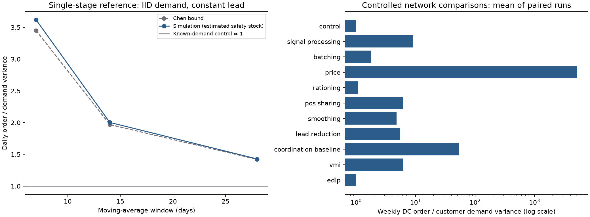

# M5 bullwhip causes and countermeasures

M5 activates the existing scenario bullwhip flags through an explicit `bullwhip`
argument to `simulate_network`. Calls without it retain M3/M4 behavior. Internal
Pydantic settings come from `configs/bullwhip.yaml`; no consumer schema, fixture or
dependency changes were needed for M5. M6 adds [disruption events](resilience.md)
that can also be used with the bullwhip configuration.

## Running the network

```python
from scm.config.bullwhip import load_bullwhip
from scm.config.loader import load_study
from scm.config.planning import load_planning
from scm.metrics.bullwhip import bullwhip_ratio, echelon_series
from scm.network.builder import build_network
from scm.network.inputs import network_inputs
from scm.sim.multi_echelon import simulate_network

study = load_study()
net = build_network(study.spec, study.scenario)
planning = load_planning()
planning.segmented = False
history, _ = network_inputs(net, study.seasonality, 550, 180)
demand, leads = network_inputs(net, study.seasonality, 551, 455)
result = simulate_network(
    net,
    demand,
    leads,
    warmup_days=90,
    planning=planning,
    demand_history=history,
    bullwhip=load_bullwhip(),
)
series = echelon_series(net, result)
ratio = bullwhip_ratio(series["dc_orders"], series["customer_demand"], warmup_days=90)
```

The example seeds and lengths illustrate the configured study horizon. The validation
runner derives independent historical/evaluation streams from its configured root
SeedSequence and pairs identical inputs across all cases. Simulation calculations
vectorize over SKU/node; the reference benchmark also vectorizes over replications.

## Mechanisms and timing

The all-off control replenishes daily toward a fixed target with continuous quantities.
Signal processing requires historical demand plus uniform planning; turning it off
freezes nominal targets even if planning settings are supplied. M5 replaces the
scenario policy family with order-up-to replenishment so each toggle has a common
control. ABC–XYZ segmentation is deliberately rejected in this experiment.

| Switch | Replenishment behavior |
| --- | --- |
| Signal processing | MA, SES or Holt updates demand mean and rolling variance after today's observations, setting tomorrow's protection target. DCs observe customer orders by default. |
| Batching | Review every `batch_days`; round positive orders to `batch_multiple` times the pack-rounded MOQ. With batching off, review daily without MOQ/pack rounding. |
| Price | On promotion days, raise the target by forecast demand × `forward_buy_days`. Apply the supplier discount to purchases dispatched during the promotion. |
| Rationing | Multiply positive desired orders by `1 + gain × max(0, threshold − previous_fill)`. Previous fill is upstream dispatch divided by all waiting orders for that SKU/destination; it is one when none are waiting. |
| POS sharing | DC forecasts observe aggregated customer consumption; physical DC inventory position still includes actual customer orders. |
| Smoothing | Order `max(0, forecast + alpha × (S − forecast − IP))`; alpha one recovers `max(0, S − IP)`. `S − forecast` is the desired post-demand position. |
| Lead reduction | Scale supplied transit days, round upward, and retain at least one day. Scale forecast-planner lead moments; fixed targets reduce mean lead coverage. Caller input arrays are unchanged. |
| VMI | Bundle POS sharing, daily replenishment without batch constraints, and removal of rationing gaming. Price behavior remains independently controlled. |
| EDLP | Disable promotional forward buying and the associated discount. |

Customer consumption and customer replenishment are observed before DC ordering.
Dispatch happens after both ordering decisions. Rationing therefore uses yesterday's
fill, never the current day's allocation. FIFO allocation, shared capacity, transit,
stock balances and backorders retain their existing meaning. Inflated orders remain
accepted; strategic cancellations are not modeled. Holding valuation remains at base
unit cost even during promotions. Retail acquisition transfer pricing is not modeled.

Reduced target lead moments approximate the rounded transit distribution and exclude
capacity waiting. Initial stock is recomputed for forecast targets; the fixed-target
control keeps the network initial stock. Warm-up removes startup from reported ratios
but its adequacy under every toggle is not established.

## Measurement and the Chen reference

`bullwhip_ratio` aggregates complete seven-day totals after warm-up and divides sample
order variance by sample customer-demand variance. It supports aligned SKU/node axes.
Zero denominator returns NaN (undefined); future JSON consumers must serialize that
as null. Fewer than two complete periods raises an error. The last incomplete week
is excluded. `echelon_series` returns network totals for customer demand, customer
orders, DC orders and supplier orders received. The last two totals are equal:
suppliers do not make another upstream purchasing decision in this model.

The V7 reference follows the IID, constant-lead, moving-average setting in
[Chen et al. (2000), Quantifying the Bullwhip Effect in a Simple Supply Chain](https://pubsonline.informs.org/doi/abs/10.1287/mnsc.46.3.436.12069).
The lower bound is `1 + 2L/p + 2L²/p²`. Orders precede the current period's demand;
the target is `L × forecast + z × estimated lead forecast-error SD`. For IID demand,
the conversion from rolling one-step forecast-error SD uses
`sqrt((L + L²/p)/(1 + 1/p))`. Signed negative orders represent the reference's
cost-free returns. The network engine always clips orders at zero.

With z zero the reference exactly satisfies
`q[t] = (1 + L/p) d[t−1] − (L/p) d[t−p−1]` after initialization, which is tested
independently. With estimated safety stock, the observed variance can exceed the
bound. V7 checks a configured approximation tolerance and a fixed-target control
near one. It measures **daily** ratios because L and p are daily periods. The
network's **weekly** ratios are not tested against that daily bound.

## Reproducible evidence

```powershell
.\.venv\Scripts\python.exe -m scm.experiments.e4_validate --output docs/evidence/m5
```

The runner exits unsuccessfully if any V7 or direction gate fails. It saves
[results](evidence/m5/results.json), [daily network series](evidence/m5/daily_series.csv),
a [source/config/output manifest](evidence/m5/manifest.json), and the figure below.
Every cause must increase weekly DC BWE in each paired replication. POS sharing,
smoothing and lead reduction compare with signal processing; VMI compares with
signal processing + batching + rationing; EDLP compares with price promotions.
These are controlled implementation checks, not confidence intervals or universal
claims about countermeasure effectiveness. M7 will add the full E4 factorial design.



The synchronized promotion calendar intentionally creates large order peaks. Its
effect size is not calibrated to a business and must not be presented as an expected
operational outcome. See [validation](validation.md) for measured results and
[parameters](parameters.md) for every new configuration assumption.
