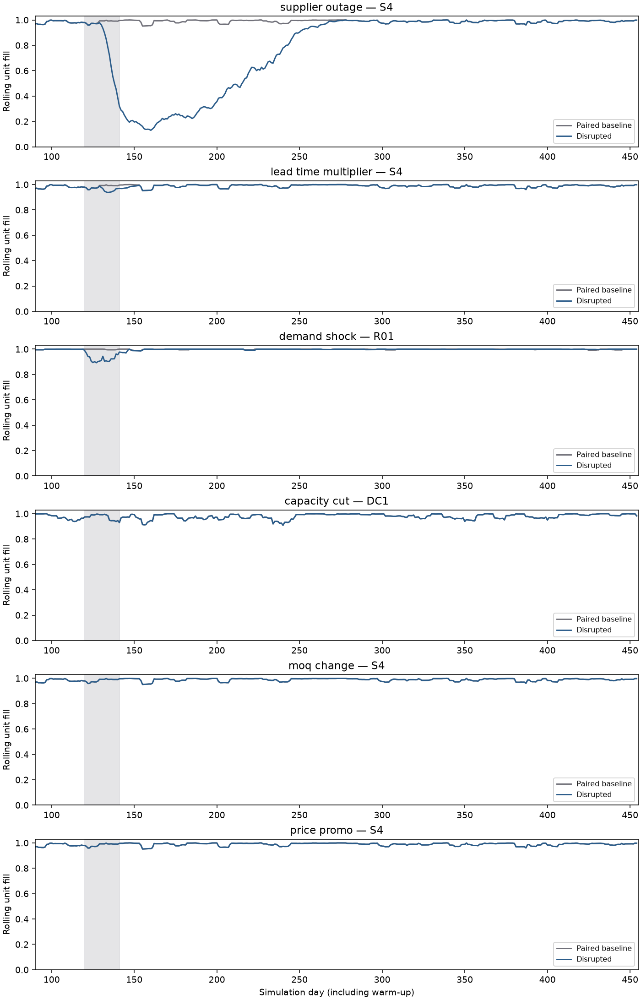

# M6 disruption engine and resilience metrics

Scenario events now flow through the configuration loader and network builder to
`simulate_network`. An empty list retains existing behavior. Events compile once
into day-indexed NumPy arrays; the simulation still loops only over days, with
vectorized SKU/node operations. There are no new dependencies or random streams.

## Event semantics

`start_day` is zero-based from simulation start, including warm-up. Events are active
on `[start_day, start_day + duration)`. Their effects stop at the exclusive end;
stock, pipeline and outstanding orders persist. Targets must exist in the **selected**
network, not merely in the candidate DC master. A lane ID is the source and destination
node IDs joined by `_`, as returned in the network contract.

| Event | Targets | Magnitude and effect |
| --- | --- | --- |
| `supplier_outage` | Supplier | Removed dispatch-capacity fraction [0,1]; one stops all new dispatches. Existing shipments still arrive. |
| `capacity_cut` | Supplier or DC | Removed dispatch-capacity fraction [0,1], shared across SKUs. |
| `lead_time_multiplier` | Supplier/DC source or lane | Positive multiplier on transit draws for orders placed during the event. Source targets affect all outgoing lanes. Rounded upward to at least one day. |
| `demand_shock` | Retailer or B2B buyer | Nonnegative multiplier on all SKU demand at that customer; zero suspends demand. |
| `moq_change` | Supplier, DC/customer destination, or lane | Positive multiplier on base MOQ. A supplier affects only its supplied SKU/DC pairs; a destination affects its incoming orders. |
| `price_promo` | Supplier or supplier-to-DC lane | Discount fraction [0,1] on purchase cost for units dispatched during the event. |

Overlapping multipliers multiply. Cuts and discounts multiply remaining fractions,
so two 50% cuts retain 25% of capacity. Order quantity and MOQ still obey pack rounding.
With M5 batching disabled, an explicit MOQ event still enforces its changed minimum.
The MOQ calendar changes the purchasing constraint, not the fixed economic lot target.
Previously accepted orders are not resized when an event starts or expires.

Transit timing follows the engine's original order-date draw convention: even a
partially dispatched order retains the event-adjusted transit of its placement date.
An event does not delay goods already in transit. Capacity is applied at dispatch,
prices at dispatch, MOQ at order placement, and demand before fulfillment/forecast
updates. Forecasts see realized shocked demand without advance event information.
Fixed policy targets remain nominal. Supplied arrays and network parameters are
not mutated. Invalid references, incompatible targets, out-of-run events and numeric
overflow are rejected.

Event price promotions affect purchase cost only; they do not automatically change
buyer demand or forward-buy targets. M5 price behavior is a separate opt-in mechanism.
If both discounts are active, their retained price fractions multiply. Holding costs
continue to use base unit value. This distinguishes a commercial price event from
the modeled buyer response, whose calibration remains outside M6.

## Measurement conventions

`paired_resilience(net, disrupted, baseline, event, window=7, tolerance=0.01)`
uses SKU/customer descendants of the target. Supplier scopes include only that
supplier's SKUs; lane scopes follow the fixed sourcing tree. All monetary differences
use the entire network, since upstream and downstream costs can both change.

- **Time-to-survive (TTS):** elapsed time from event start to the first affected
  SKU/customer shortage. Within its first shortage day, immediate fulfilled units
  divided by that day's demand gives fractional coverage, assuming uniform daily
  consumption. With no replenishment or backlog, stock 25 and demand 10/day gives
  2.5 days. No observed shortage returns null, censored at the horizon. A shortage
  can also exist in the baseline; TTS alone does not establish event causation.
- **Time-to-recover (TTR):** elapsed days to the close of the first eligible day whose
  rolling affected-customer fill reaches paired baseline fill minus the tolerance,
  after the first observed rolling service breach. Fill is sum of immediate units
  divided by sum of demand over the window, not an average of daily ratios. Recovery
  requires a full post-start window. Initial healthy days do not count as recovery
  when a later breach is observed. No breach gives zero; no recovery or no measurable
  demand gives null. This is first recovery, not a guarantee against later relapse.
- **Disruption cost:** signed sum of daily network cost differences from event start
  through the supplied horizon. It includes all eight cost accounts and can be
  negative. Costs beyond the horizon are not estimated. For overlapping events,
  this is their combined paired effect, not an allocation to individual causes.
- **Lost-sales units:** total lost units from event start, plus a separate difference
  versus baseline. Backorder-mode runs report zero because unmet demand becomes backlog.

The paired baseline must use the same input streams, configuration, policy and lost-sales
mode with events removed. The function checks aligned series and warm-up; provenance
is the caller's responsibility. Zero-demand rolling windows are undefined, not perfect
service. Runtime results retain the shocked demand actually used by the simulation.

## Run and inspect

```python
from scm.config.loader import load_study
from scm.contracts import Disruption
from scm.metrics.resilience import paired_resilience
from scm.network.builder import build_network
from scm.network.inputs import network_inputs
from scm.sim.multi_echelon import simulate_network

study = load_study()
net = build_network(study.spec, study.scenario)
demand, leads = network_inputs(net, study.seasonality, 606, 455)
baseline = simulate_network(net, demand, leads, warmup_days=90)
event = Disruption(type="supplier_outage", target="S4", start_day=120, duration=21, magnitude=1.0)
net.scenario.disruptions = [event]
disrupted = simulate_network(net, demand, leads, warmup_days=90)
metrics = paired_resilience(net, disrupted, baseline, event, window=7, tolerance=0.01)
```

The values illustrate `configs/m6_validation.yaml`; production scenario events should
be stored in scenario YAML. The reproducible acceptance command is:

```powershell
.\.venv\Scripts\python.exe -m scm.experiments.e6_validate --output docs/evidence/m6
```

It checks TTS in the actual network engine, then runs all six event types separately
on two paired SeedSequence streams and repeats every disturbed run. Gates require
identical service histories, cost histories and resilience metrics. It saves
[results](evidence/m6/results.json), [daily series](evidence/m6/daily_series.csv), a
[manifest](evidence/m6/manifest.json), and this first-replication figure:



The shaded interval is the event, not its full downstream impact. The saved capacity
cut and MOQ settings are nonbinding in these network runs and produce zero paired
cost differences; unit tests separately exercise binding cases. Price promotions
reduce purchase cost without changing service. See [validation](validation.md) for
numbers and [parameters](parameters.md) for assumptions.

M6 implements events and metrics. E6 mitigation sweeps, the ±20% sensitivity design,
confidence intervals and reproducible Parquet output remain M7 work. Dual sourcing,
lateral transshipment and a dedicated expedite policy are not implemented in this
fixed-sourcing engine. No calibrated operational resilience claims are made.
