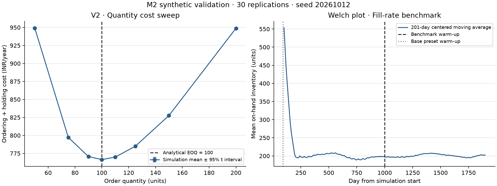

# Single-node simulation (M2)

`scm.demand.generator` pre-draws normal demand factors and lead/delay/B2B variates
using four `SeedSequence.spawn` streams. Arrays are day × SKU × node. Regional
normal factors are shared within a region for each SKU. Lead and supplier-delay
uniforms are indexed by node/edge and order day, shared across SKUs on that edge.
Policy changes never advance a random generator inside the simulation.

`demand(streams, mean, std, ...)` supports nonnegative-censored normal demand,
gamma slow movers via a Gaussian copula, and Bernoulli arrivals with lognormal
B2B order sizes. For B2B, mean/std describe the size conditional on arrival;
daily mean is arrival probability × size mean. At most one B2B order occurs per
SKU-node-day. Regional correlation applies to the latent normal factors; gamma
Pearson correlation can differ. B2B orders are independent and reject nonzero rho.
Trend affects the mean linearly; a caller supplies daily seasonal multipliers.
`monthly_seasonality` expands twelve indices over a repeating non-leap calendar.
`configs/demand.yaml` currently provides the neutral `monthly_index_v1` profile.

`lead_days` uses inverse gamma CDF values (or fixed lead time at CV=0), rounds up,
and enforces a minimum of one day. Quantization changes the lead-time moments;
validation output records the realized moments. Reuse canonical axes, horizon
length and seeds when pairing scenarios. The benchmark spawns independent
replication seeds so adding replications preserves earlier ones.

## Daily engine

`simulate(demand, lead_times, config)` takes day × series arrays and a validated
`SingleNodeConfig`. Columns are independent replications or SKUs sharing scalar
policy/cost parameters. The daily loop is vectorized across columns:

1. Receive arrivals and close the previous receipt-to-receipt service cycle.
2. Fill old backorders first, then today's demand. Only immediate fulfillment
   contributes to fill rate; a later backlog fill never retroactively improves it.
3. Compute inventory position: on-hand + pipeline − backorders. If below R,
   order enough fixed-Q lots to restore position to at least R. Equality does
   not trigger an order. Each lot incurs its own setup cost.
4. An unlimited supplier dispatches immediately. An order on day t with L days
   of lead time arrives before demand on day t+L. Orders arriving after the
   horizon remain in the ending pipeline.
5. Record state and costs. Lost-sales mode discards shortages instead of backordering.

Purchase cost is charged on dispatch. Holding cost uses the stock-time area with
uniform demand depletion within each day, after opening backlog clearance; when
stock runs out, holding cost stops at that fraction of the day. Shortage penalty
applies once per newly unfilled unit, not repeatedly per backlog-day. Initial
stock is supplied as an opening balance; no opening purchase cost is charged.

Cycle service level uses complete receipt-to-receipt cycles whose start is on or
after warm-up; initial, final and warm-up-straddling cycles are excluded. Any
shortfall in the cycle marks it unsuccessful. Fill rate and costs use measured
days only. Undefined fill rate (no demand) or CSL (no complete cycles) is NaN in
internal NumPy outputs; a future API adapter must serialize undefined values as null.

## Reproduce validation

```powershell
.\.venv\Scripts\python.exe -m scm.sim.validate --output docs/evidence/m2
```

The command saves [checks and configuration](evidence/m2/results.json),
[source/output hashes and package versions](evidence/m2/manifest.json),
[cost sweep by replication](evidence/m2/q_sweep.csv),
[warm-up observations](evidence/m2/welch.csv), and the plot below. It exits with
failure if any acceptance criterion fails. `make check` runs the same numerical
acceptance cases through pytest, without regenerating the checked-in evidence.



These are synthetic validation experiments. V1 includes purchasing costs and
requires zero stockouts. V2 compares ordering-plus-holding cost at common demand
draws. V3 tests fixed and variable leads. V4 solves for a 95% fill-rate target.
V6 independently matches FIFO unit arrivals/departures (midday average departure)
in a steady deterministic case. V8 compares paired cost-difference variance to
an independent second scenario, and verifies repeatability.

The long-lead service benchmarks use a 1000-day warm-up to clear initialization;
the Welch plot supports assessment of that setting. The planned network's 90-day
warm-up remains unvalidated until M3. Daily review, demand censoring, lead rounding,
and overlapping replenishments can make continuous-review approximations inaccurate
elsewhere. Passing these named cases does not prove every scenario's target is met.

M3 adds multi-echelon constraints and policy rounding; M4 adds forecast updates.
M2 uses fixed known-demand policy parameters. Supplier capacity, actual delay events,
freight, outages, multi-node allocation, and the full M7 experiment framework are
not implemented here. Supplier-delay variates are reserved for those later stages.
